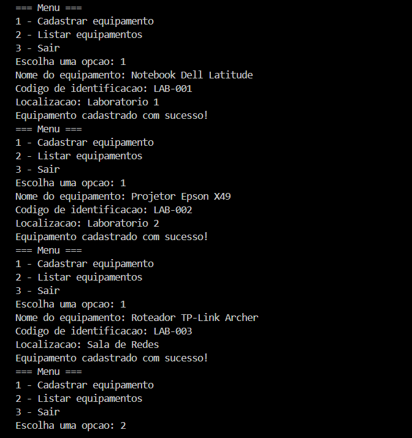
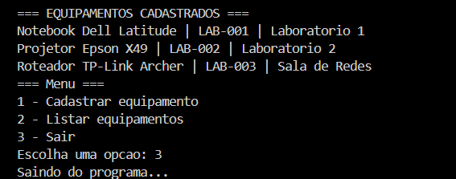

# 🖥️ Cadastro de Equipamentos em C | Equipment Registry in C


🇧🇷 [Português](#-português) | 🇺🇸 [English](#-english)

---

## 🇧🇷 Português

### 📌 Identificação

- **Aluno:** Piêtro Bitencourt Nunes
- **Instituição:** Centro Universitário do Distrito Federal (UDF)
- **Disciplina:** Desenvolvimento de Algoritmos e Programação em C
- **Atividade:** Prática — Cadastro de Equipamentos em C (0,5 ponto, individual)

### 🎯 Objetivo

Um laboratório de informática precisa de um sistema simples para cadastrar e consultar seus equipamentos. Este programa em C permite informar os dados de cada equipamento, armazená-los em um arquivo de texto (`equipamentos.txt`) e consultá-los depois, preservando os registros já existentes.

### ⚙️ Funcionamento

O programa exibe um menu que se repete até o usuário escolher **Sair**:

| Opção | Ação |
|-------|------|
| `1` | **Cadastrar equipamento**: pede nome, código de identificação e localização e grava uma linha no arquivo |
| `2` | **Listar equipamentos**: lê o arquivo e exibe todos os registros na tela |
| `3` | **Sair**: encerra o programa |

Qualquer outra entrada mostra uma mensagem de opção inválida e o menu volta a ser exibido.

### 🧠 Lógica e decisões

- **Menu:** estrutura `do...while` com `switch`, repetindo até a opção `3`.
- **Leitura da opção:** `fgets` + `atoi` em vez de `scanf`, evitando que o `\n` que sobra no buffer atrapalhe as leituras seguintes. Isso também faz com que letras ou entradas vazias caiam em "opção inválida".
- **Entrada de dados:** cada campo é lido com `fgets` e o `\n` final é removido com `strcspn`, para que cada equipamento ocupe exatamente uma linha no arquivo.
- **Formato do registro:** uma linha por equipamento, com os campos separados por ` | `:
  `Nome | Código | Localização`
- **Preservação dos registros:** o arquivo é aberto no modo `"a"` (append) no cadastro, de modo que os equipamentos anteriores não são apagados.
- **Tratamento de erros:** o retorno do `fopen` é verificado (`NULL`). Se o arquivo ainda não existir, a listagem avisa que não há equipamentos cadastrados.
- **Organização:** o código é dividido em três funções (`exibirMenu`, `cadastrarEquipamento` e `listarEquipamentos`), e o nome do arquivo e o tamanho dos textos são definidos com `#define`.

### 📚 Funções de arquivo utilizadas

| Função | Uso no programa |
|--------|-----------------|
| `fopen()` | Abre o arquivo em modo `"a"` (cadastro) e `"r"` (listagem) |
| `fprintf()` | Grava o registro formatado no arquivo |
| `fgets()` | Lê a entrada do usuário e as linhas do arquivo |
| `fclose()` | Fecha o arquivo após o uso |

### 📁 Estrutura da pasta

```
cadastro-equipamentos/
├── cadastro_equipamentos.c        # código-fonte
├── equipamentos.txt               # exemplo de arquivo gerado pelo programa
├── README.md                      # este arquivo
└── evidencias/
    ├── cadastrarEquipamento.png   # print do cadastro
    └── listarEquipamento.png      # print da listagem
```

### ▶️ Como compilar e executar

Pré-requisito: compilador GCC instalado.

```bash
# Compilar
gcc cadastro_equipamentos.c -o cadastro_equipamentos

# Executar (Linux/macOS)
./cadastro_equipamentos

# Executar (Windows)
cadastro_equipamentos.exe
```

O arquivo `equipamentos.txt` é criado automaticamente no primeiro cadastro, na pasta de onde o programa é executado.

### 💻 Exemplo de entrada e saída

```
=== Menu ===
1 - Cadastrar equipamento
2 - Listar equipamentos
3 - Sair
Escolha uma opcao: 1
Nome do equipamento: Notebook Dell Latitude
Codigo de identificacao: LAB-001
Localizacao: Laboratorio 1
Equipamento cadastrado com sucesso!

=== Menu ===
1 - Cadastrar equipamento
2 - Listar equipamentos
3 - Sair
Escolha uma opcao: 2

=== EQUIPAMENTOS CADASTRADOS ===
Notebook Dell Latitude | LAB-001 | Laboratorio 1
Projetor Epson X49 | LAB-002 | Laboratorio 2
Roteador TP-Link Archer | LAB-003 | Sala de Redes
```

### 📄 Exemplo de `equipamentos.txt`

```
Notebook Dell Latitude | LAB-001 | Laboratorio 1
Projetor Epson X49 | LAB-002 | Laboratorio 2
Roteador TP-Link Archer | LAB-003 | Sala de Redes
```

### 🖼️ Evidências de execução

**Cadastro de equipamento (opção 1):**



**Listagem de equipamentos (opção 2):**



### ✅ Testes realizados

- Cadastro de três equipamentos em execuções diferentes, confirmando que os registros anteriores foram preservados.
- Listagem sem o arquivo `equipamentos.txt` existente (mensagem de que não há equipamentos).
- Opção inválida no menu (número fora do intervalo e letra), sem travar o programa.

### 🔮 Possíveis melhorias

- Validar código duplicado antes de cadastrar.
- Permitir buscar, editar e remover equipamentos.
- Ampliar o buffer de leitura da opção do menu.

---

## 🇺🇸 English

### 📌 Identification

- **Student:** Piêtro Bitencourt Nunes
- **Institution:** Centro Universitário do Distrito Federal (UDF)
- **Course:** Algorithm Development and C Programming
- **Assignment:** Hands-on — Equipment Registry in C (0.5 point, individual)

### 🎯 Objective

A computer lab needs a simple system to register and look up its equipment. This C program lets the user enter each item's data, stores it in a text file (`equipamentos.txt`) and displays it later, keeping all existing records.

### ⚙️ How it works

The program shows a menu that repeats until the user chooses **Exit**:

| Option | Action |
|--------|--------|
| `1` | **Register equipment**: asks for name, ID code and location, then writes one line to the file |
| `2` | **List equipment**: reads the file and prints every record on screen |
| `3` | **Exit**: ends the program |

Any other input prints an invalid-option message and the menu is shown again.

### 🧠 Logic and design decisions

- **Menu:** `do...while` loop with a `switch`, repeating until option `3`.
- **Reading the option:** `fgets` + `atoi` instead of `scanf`, so the leftover `\n` in the buffer does not break later reads. Letters or empty input fall into "invalid option".
- **Data input:** each field is read with `fgets` and the trailing `\n` is removed with `strcspn`, so every item takes exactly one line in the file.
- **Record format:** one line per item, fields separated by ` | `:
  `Name | Code | Location`
- **Keeping existing records:** the file is opened in `"a"` (append) mode when registering, so previous items are never erased.
- **Error handling:** the `fopen` return value is checked (`NULL`). If the file does not exist yet, the listing reports that no equipment has been registered.
- **Organization:** the code is split into three functions (`exibirMenu`, `cadastrarEquipamento` and `listarEquipamentos`), and the file name and text size are defined with `#define`.

### 📚 File functions used

| Function | Use in the program |
|----------|--------------------|
| `fopen()` | Opens the file in `"a"` (register) and `"r"` (list) modes |
| `fprintf()` | Writes the formatted record to the file |
| `fgets()` | Reads user input and file lines |
| `fclose()` | Closes the file after use |

### 📁 Folder structure

```
cadastro-equipamentos/
├── cadastro_equipamentos.c        # source code
├── equipamentos.txt               # sample file generated by the program
├── README.md                      # this file
└── evidencias/
    ├── cadastrarEquipamento.png   # registration screenshot
    └── listarEquipamento.png      # listing screenshot
```

### ▶️ How to compile and run

Requirement: GCC compiler installed.

```bash
# Compile
gcc cadastro_equipamentos.c -o cadastro_equipamentos

# Run (Linux/macOS)
./cadastro_equipamentos

# Run (Windows)
cadastro_equipamentos.exe
```

`equipamentos.txt` is created automatically on the first registration, in the folder the program is run from.

### 🖼️ Execution evidence

**Registering equipment (option 1):**


**Listing equipment (option 2):**


### ✅ Tests performed

- Registered three items across different runs, confirming previous records were kept.
- Listed with no `equipamentos.txt` present (reports no equipment).
- Invalid menu option (out-of-range number and a letter) without crashing.

### 🔮 Possible improvements

- Check for duplicate codes before registering.
- Add search, edit and delete features.
- Enlarge the menu option read buffer.

---

👨‍💻 **Autor / Author:** [Piêtro Bitencourt Nunes](https://github.com/pietrobitencourt) · [LinkedIn](https://www.linkedin.com/in/piiettrosz/)
