# 🏥 Sistema de Senhas de Atendimento | Clinic Queue Ticket System


-blueviolet)
-orange)


**🌐 Idioma / Language:** [🇧🇷 Português](#pt) · [🇺🇸 English](#en)

---

<a id="pt"></a>

# 🇧🇷 Português

Prova final da disciplina de **Algoritmo e Pensamento Computacional** — **Tema 2**: gerenciamento de senhas de atendimento de uma clínica de especialidades médicas.

| | |
|---|---|
| 👤 **Autor** | Piêtro Bitencourt Nunes |
| 📚 **Disciplina** | Algoritmo e Pensamento Computacional |
| 👩‍🏫 **Professora** | Karla Sartin |
| 🏫 **Instituição** | UDF |
| 💻 **Linguagem** | C (padrão C99 ou superior) |

## 📑 Sumário

1. [Objetivo](#pt-objetivo)
2. [Funcionalidades](#pt-funcionalidades)
3. [Regras de funcionamento](#pt-regras)
4. [Estrutura do projeto](#pt-estrutura)
5. [Estruturas de dados](#pt-dados)
6. [Funções implementadas](#pt-funcoes)
7. [Requisitos da atividade](#pt-requisitos)
8. [Como compilar e executar](#pt-executar)
9. [Exemplos de utilização](#pt-exemplos)
10. [Decisões de projeto](#pt-decisoes)
11. [Testes e evidências](#pt-evidencias)
12. [Limitações](#pt-limitacoes)

<a id="pt-objetivo"></a>

## 🎯 1. Objetivo

Desenvolver, em linguagem C, um sistema de linha de comando que gerencia as **senhas de atendimento** de uma clínica de especialidades médicas. O sistema cadastra o paciente, classifica a senha em uma de três categorias (Urgente, Preferencial ou Normal), organiza a fila de espera respeitando as prioridades e permite registrar a chamada e a finalização de cada atendimento, exibindo sempre um painel com a situação atual.

> ⚠️ **Observação:** a classificação de urgência por idade não substitui a avaliação clínica. Trata-se exclusivamente de uma regra de programação definida para esta atividade.

<a id="pt-funcionalidades"></a>

## ✨ 2. Funcionalidades

- **Cadastro do paciente**: nome, idade, gênero e, para mulheres, se está gestante e se está lactante; para todos, se possui condição de obesidade e se possui alguma necessidade especial.
- **Classificação automática** da senha:

  | Categoria | Letra | Critério |
  |---|---|---|
  | Urgente | `U` | idade **maior que 80 anos** |
  | Preferencial | `P` | gestante, lactante, condição de obesidade ou necessidade especial |
  | Normal | `N` | demais casos |

- **Geração de senhas** no formato `N001`, `P001`, `U001`, com **numeração independente por categoria** e sem repetição.
- **Menu interativo**:
  - `[1] Retirar senha`
  - `[2] Registrar atendimento` (chamar a próxima senha e finalizar o atendimento atual)
  - `[0] Sair`
- **Painel de chamada**, exibido a cada volta do menu: senha em atendimento e sua categoria, próxima senha a ser chamada, senhas aguardando por categoria (em ordem de chegada) e quantidade de pacientes em espera por categoria.
- **Cadastro de vários pacientes** durante a mesma execução.
- **Validação de entradas** e tratamento de operações inválidas.

<a id="pt-regras"></a>

## 📏 3. Regras de funcionamento

1. Senhas **Urgentes** são chamadas antes das **Preferenciais**, que são chamadas antes das **Normais**.
2. **Dentro de cada categoria**, vale a ordem de emissão das senhas (FIFO: o primeiro a chegar é o primeiro a ser chamado).
3. Uma senha já atendida **não retorna** à fila.
4. Só é possível chamar um novo paciente quando **não há atendimento em andamento**.
5. Se a fila de uma categoria estiver cheia, a senha **não é emitida** e o contador daquela categoria **não avança** (operação "tudo ou nada"), de modo que a numeração nunca tem "buracos".

<a id="pt-estrutura"></a>

## 🗂️ 4. Estrutura do projeto

```
clinica-senhas/
├── include/            Arquivos de cabeçalho (.h)
│   ├── tipos.h
│   ├── entrada.h
│   ├── paciente.h
│   ├── fila.h
│   ├── senha.h
│   ├── atendimento.h
│   └── painel.h
├── src/                Código-fonte (.c)
│   ├── main.c
│   ├── entrada.c
│   ├── paciente.c
│   ├── fila.c
│   ├── senha.c
│   ├── atendimento.c
│   └── painel.c
├── evidencias/         Capturas de tela dos testes
├── output/             Executável gerado (não versionado)
└── README.md
```

| Módulo | Responsabilidade |
|---|---|
| `tipos.h` | Constantes e estruturas de dados (`Paciente`, `Fila`, `Sistema`) |
| `entrada` | Leitura e validação dos dados digitados |
| `paciente` | Cadastro, classificação e nome da categoria |
| `fila` | Fila circular e estado inicial do sistema |
| `senha` | Geração das senhas e retirada de senha (opção 01 do menu) |
| `atendimento` | Consulta, chamada e finalização de atendimentos (opção 02 do menu) |
| `painel` | Menu e painel de chamada |
| `main.c` | Apenas coordena: inicializa o sistema e repete o menu |

<a id="pt-dados"></a>

## 🧱 5. Estruturas de dados

- **`Paciente`** (`struct`): nome, idade, gênero, gestante, lactante, obesidade, necessidade especial, categoria, número da senha e código (por exemplo, `"P003"`).
- **`Fila`** (`struct`): **fila circular** implementada com um array de `Paciente`, um índice `inicio` e um contador `quantidade`.
- **`Sistema`** (`struct`): reúne as três filas (`filaU`, `filaP`, `filaN`), os três contadores de senhas emitidas, o paciente em atendimento e o indicador `emAtendimento`. Não há variáveis globais: o estado é criado no `main()` e passado às funções por ponteiro.

### Fila circular

Em uma fila feita com array simples, o índice de entrada só cresce, e a fila ficaria "cheia" mesmo estando vazia depois de muitos atendimentos. Na fila circular, os índices **dão a volta** no array usando o operador `%`:

| Operação | Como funciona |
|---|---|
| Fila vazia | `quantidade == 0` |
| Fila cheia | `quantidade == MAX_FILA` |
| Entrar | grava em `itens[(inicio + quantidade) % MAX_FILA]` e faz `quantidade++` |
| Sair | lê `itens[inicio]`, faz `inicio = (inicio + 1) % MAX_FILA` e `quantidade--` |

Com isso, a capacidade de **50 pacientes** (`MAX_FILA`) por categoria vale para pacientes **aguardando ao mesmo tempo**, e não para o total de senhas emitidas no dia.

<a id="pt-funcoes"></a>

## 🧩 6. Funções implementadas

**`entrada.c`**

| Função | Descrição |
|---|---|
| `lerInteiro` | Lê um inteiro dentro de uma faixa; repete até a entrada ser válida |
| `lerSimNao` | Lê uma resposta `s`/`n` (aceita maiúsculas) e devolve 1 ou 0 |
| `lerTexto` | Lê um texto não vazio e remove a quebra de linha |

**`paciente.c`**

| Função | Descrição |
|---|---|
| `cadastrarPaciente` | Faz as perguntas e devolve o paciente preenchido |
| `classificarPaciente` | Devolve `U`, `P` ou `N` conforme as regras |
| `nomeCategoria` | Converte a letra da categoria em texto ("Urgente", "Preferencial", "Normal") |

**`fila.c`**

| Função | Descrição |
|---|---|
| `inicializarSistema` | Zera todo o sistema (filas vazias, contadores em 0, ninguém em atendimento) |
| `filaCheia` | Informa se a fila está cheia |
| `enfileirar` | Coloca um paciente no fim da fila (devolve 0 se estiver cheia) |
| `desenfileirar` | Retira o primeiro da fila (devolve 0 se estiver vazia) |
| `quantidadeNaFila` | Informa quantos pacientes aguardam |
| `obterFila` | Devolve o endereço da fila da categoria informada |

**`senha.c`**

| Função | Descrição |
|---|---|
| `gerarSenha` | Incrementa o contador da categoria e monta o código da senha (`%c%03d`) |
| `retirarSenha` | Cadastra, classifica, verifica espaço na fila, gera a senha e enfileira |

**`atendimento.c`**

| Função | Descrição |
|---|---|
| `consultarProxima` | Informa a categoria da próxima senha (U, depois P, depois N), sem retirar ninguém |
| `chamarProxima` | Retira o próximo da fila e o coloca em atendimento |
| `finalizarAtendimento` | Encerra o atendimento atual |
| `registrarAtendimento` | Submenu da opção 02: chamar próxima, finalizar atendimento ou voltar |

**`painel.c`**

| Função | Descrição |
|---|---|
| `exibirMenu` | Mostra as opções do menu principal |
| `exibirPainel` | Mostra o painel de chamada (somente leitura) |
| `listarFila` *(interna)* | Lista os códigos de uma fila, em ordem de chegada |
| `filaDaCategoria` *(interna)* | Devolve a fila de uma categoria sem permitir alterá-la |

**`main.c`**

| Função | Descrição |
|---|---|
| `main` | Inicializa o sistema e repete o painel e o menu até o usuário escolher sair |

<a id="pt-requisitos"></a>

## ✅ 7. Requisitos da atividade

| Requisito | Onde foi atendido |
|---|---|
| Aplicação funcional em C | Todo o projeto |
| Modularização em funções com responsabilidades específicas | Seção 6 |
| `main()` sem a lógica integral | `main.c` apenas coordena as chamadas |
| Estruturas de decisão | `if / else if` (classificação, validações) e `switch` (menus, categorias) |
| Estruturas de repetição | `do...while` (menu e validação de inteiros), `while` (leitura de sim/não e texto), `for` (listagem das filas) |
| Tipos de dados e estruturas de armazenamento apropriadas | `struct`, arrays e fila circular |
| Menu interativo | `exibirMenu` e `registrarAtendimento` |
| Validação de dados e operações inválidas | Seção 9 |

<a id="pt-executar"></a>

## ▶️ 8. Como compilar e executar

**Pré-requisito:** compilador `gcc` instalado (no Windows, por exemplo, MinGW-w64 ou MSYS2).

> ⚠️ Os comandos devem ser executados **dentro da pasta `clinica-senhas`**, onde ficam `src/` e `include/`. Se o terminal estiver na raiz do repositório, entre na pasta primeiro.

### Windows (PowerShell)

```powershell
cd clinica-senhas
New-Item -ItemType Directory -Force output
gcc -Wall -Wextra -Iinclude (Get-ChildItem src\*.c).FullName -o output\clinica_senhas
.\output\clinica_senhas
```

Se preferir não usar o `Get-ChildItem`, liste os arquivos:

```powershell
gcc -Wall -Wextra -Iinclude src\main.c src\entrada.c src\paciente.c src\fila.c src\senha.c src\atendimento.c src\painel.c -o output\clinica_senhas
```

### Linux / macOS

```bash
cd clinica-senhas
mkdir -p output
gcc -Wall -Wextra -Iinclude src/*.c -o output/clinica_senhas
./output/clinica_senhas
```

O parâmetro `-Iinclude` informa ao compilador onde estão os arquivos `.h`. O projeto compila **sem nenhum aviso** com `-Wall -Wextra`.

### No VS Code

1. Abra o terminal integrado (`` Ctrl + ` ``).
2. Entre na pasta do projeto com `cd clinica-senhas`.
3. Execute os comandos de compilação e execução acima.

<a id="pt-exemplos"></a>

## 💡 9. Exemplos de utilização

### Retirando uma senha

```
Escolha uma opcao: 1

=== RETIRAR SENHA ===
Nome: Maria Silva
Idade: 30
Genero:
[1] Feminino
[2] Masculino
Genero: 1
Esta gestante? (s/n): s
Esta lactante? (s/n): n
Possui condicao de obesidade? (s/n): n
Possui alguma necessidade especial? (s/n): n
Sua senha: P001 (Preferencial)
```

### Painel com pacientes aguardando

Depois de retirar quatro senhas (uma Preferencial, duas Normais e uma Urgente), o painel mostra:

```
==============================================
      CLINICA DE ESPECIALIDADES MEDICAS
              PAINEL DE CHAMADA
==============================================
 EM ATENDIMENTO: nenhuma
 PROXIMA SENHA:  U001 (Urgente)
----------------------------------------------
 AGUARDANDO (ordem de chamada):
   Urgente       (1): U001
   Preferencial  (1): P001
   Normal        (2): N001 N002
==============================================
```

### Chamando a próxima senha

```
Escolha uma opcao: 2
Proxima a ser chamada: categoria U
[1] Chamar proxima senha
[2] Finalizar atendimento atual
[0] Voltar
Escolha uma opcao: 1
Chamando: U001 - Ana Costa
```

Em seguida, o painel passa a mostrar `EM ATENDIMENTO: U001 (Urgente)` e `PROXIMA SENHA: P001 (Preferencial)`. A senha `U001` é chamada primeiro, mesmo tendo sido emitida depois de `P001` e `N001`, porque a categoria Urgente tem precedência.

### Operações inválidas tratadas

| Situação | Mensagem do sistema |
|---|---|
| Chamar com todas as filas vazias | `Nenhum paciente aguardando.` |
| Chamar com um atendimento em andamento | `Finalize o atendimento atual antes de chamar o proximo.` |
| Finalizar sem atendimento em andamento | `Nenhum atendimento em andamento.` |
| Fila da categoria cheia | `Fila de atendimento cheia. Tente novamente mais tarde.` |
| Opção de menu inválida, idade inválida ou texto não numérico | `Valor invalido. Digite um numero entre X e Y.` |
| Resposta diferente de `s`/`n` | `Responda com s (sim) ou n (nao).` |
| Nome vazio | `O texto nao pode ser vazio.` |

<a id="pt-decisoes"></a>

## 🧠 10. Decisões de projeto

- **Idade urgente:** a regra é "mais de 80 anos", portanto quem tem exatamente 80 anos **não** é classificado como Urgente. Uma gestante com mais de 80 anos é Urgente, pois a verificação de urgência vem primeiro.
- **Gestante e lactante:** essas perguntas só são feitas quando o gênero informado é feminino. Para os demais pacientes, os campos permanecem em "não".
- **Lactante e obesidade:** foram tratadas como critérios de categoria Preferencial, junto com gestante e necessidade especial.
- **Retirada de senha "tudo ou nada":** o sistema classifica o paciente e verifica se há espaço na fila **antes** de gerar o número, para que uma recusa não consuma uma senha.
- **Submenu de atendimento:** a opção 02 executa **uma ação por vez** (chamar ou finalizar) e retorna ao menu principal, que exibe o painel atualizado.
- **Painel somente leitura:** `exibirPainel` e `consultarProxima` recebem o sistema como `const`, o que garante que não alteram nenhum dado.

<a id="pt-evidencias"></a>

## 🧪 11. Testes e evidências

### Classificação

| Caso | Resultado esperado |
|---|---|
| Homem, 81 anos, sem condições | `U` |
| Homem, 80 anos, sem condições | `N` |
| Homem, 80 anos, necessidade especial | `P` |
| Mulher, 85 anos, gestante | `U` |
| Mulher, 30 anos, gestante | `P` |
| Mulher, 30 anos, lactante | `P` |
| Homem, 40 anos, obesidade | `P` |
| Mulher, 25 anos, sem condições | `N` |

### Prioridade e ordem de chegada

Emitindo, nesta ordem, `N001`, `N002`, `P001` e `U001`, as chamadas ocorrem na ordem **U001, P001, N001, N002**.

### 📸 Capturas de tela

> Capturas feitas com a extensão **TermSnap** do VS Code e salvas na pasta [`evidencias/`](evidencias/).

#### 1. Compilação sem avisos
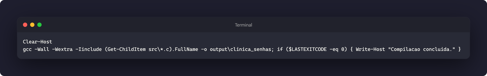

#### 2. Menu e painel iniciais (nenhuma senha emitida)
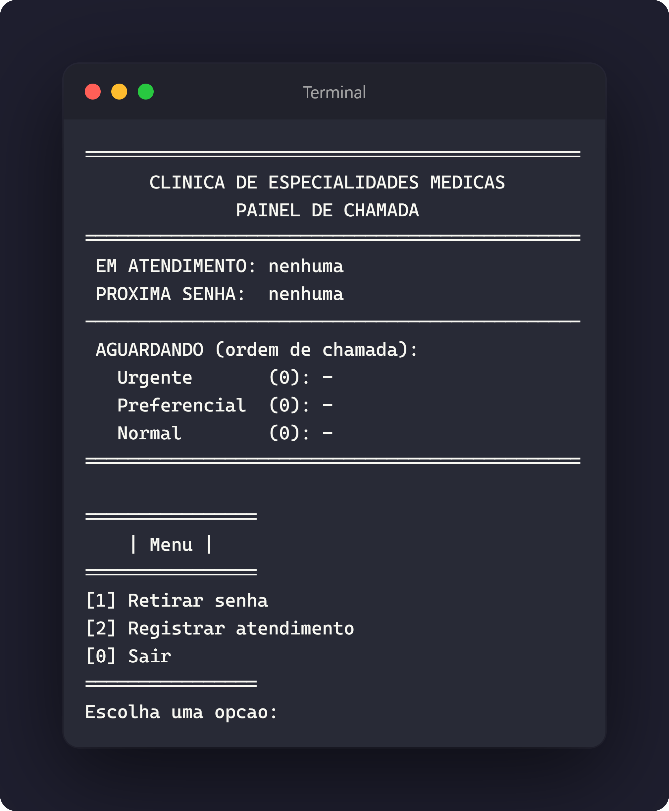

#### 3. Senha Preferencial (paciente gestante)
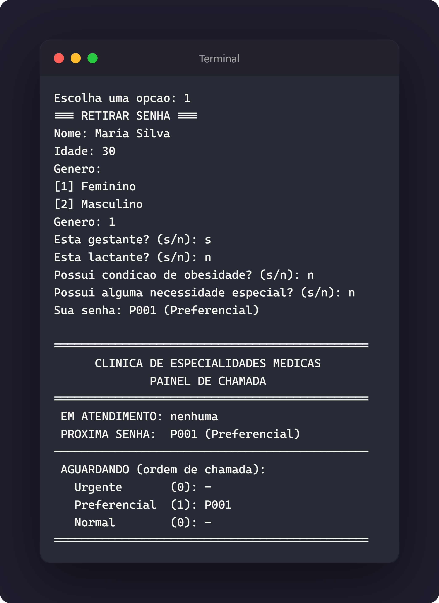

#### 4. Senha Urgente (paciente com mais de 80 anos)
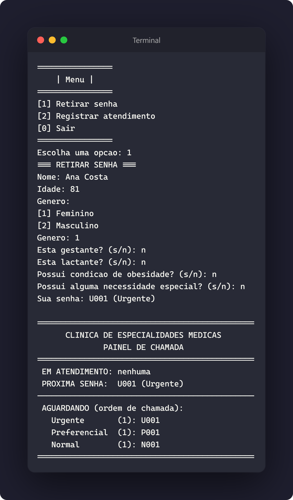

#### 5. Senha Normal
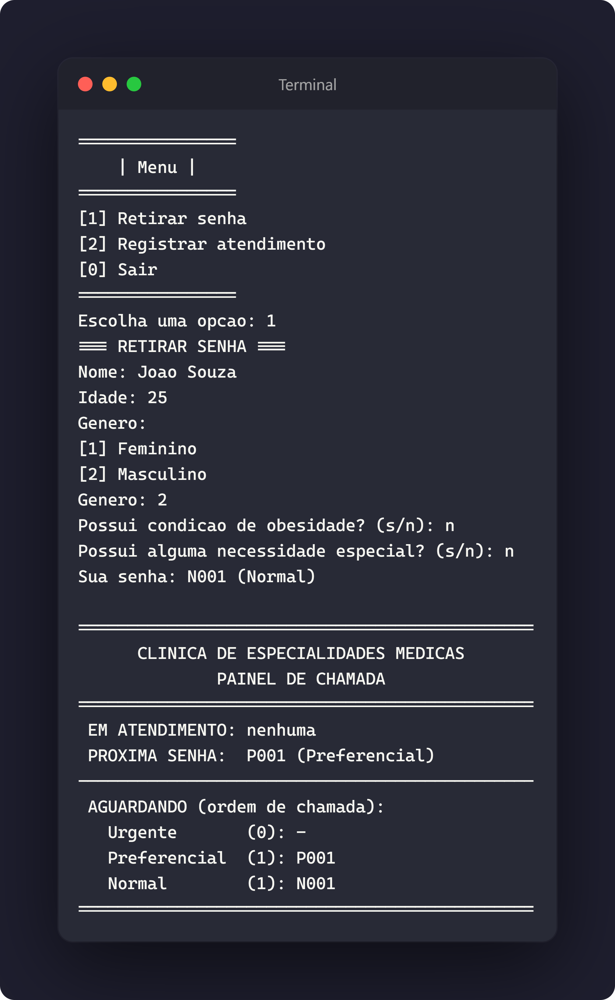

#### 6. Painel com pacientes aguardando nas três categorias
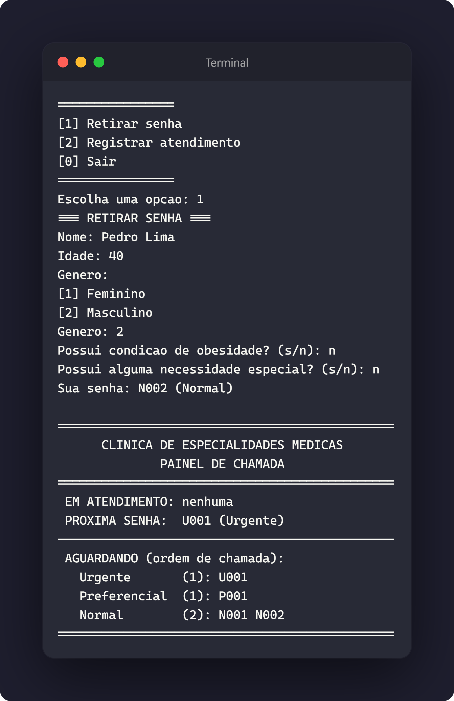

#### 7. Chamada respeitando a prioridade (Urgente antes dos demais)
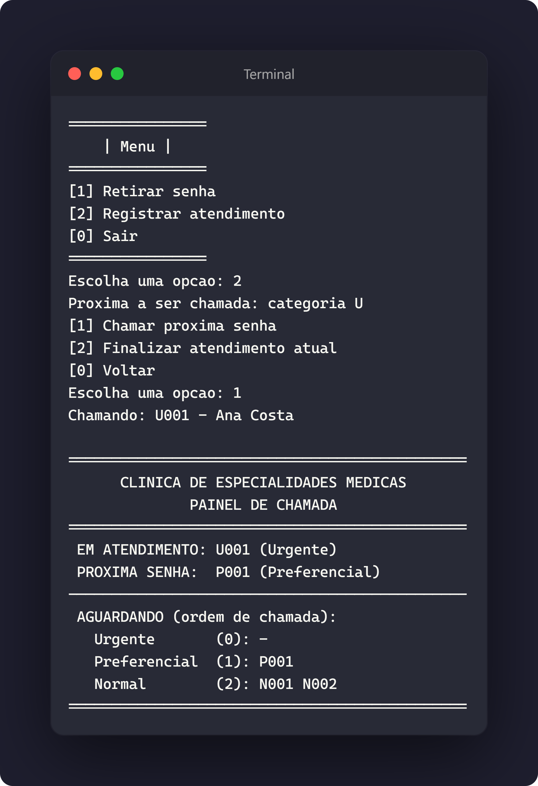

#### 8. Ordem de chegada dentro da mesma categoria
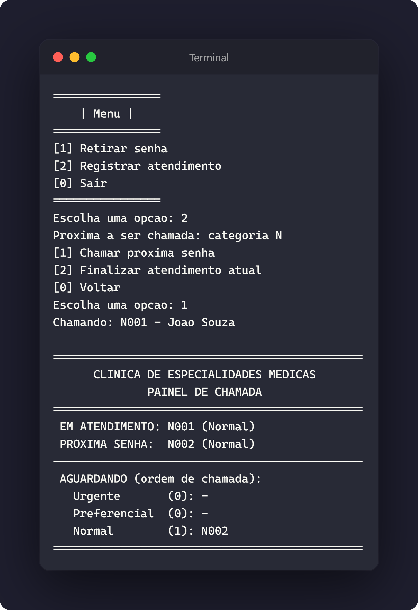

#### 9. Finalização de atendimento
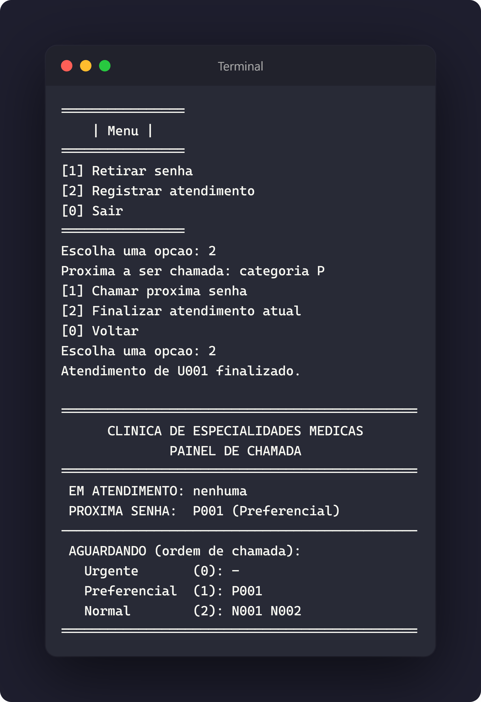

#### 10. Operações inválidas tratadas


#### 11. Validação das entradas


#### 12. Fila cheia sem consumir número de senha
*(teste com `MAX_FILA` reduzido temporariamente)*

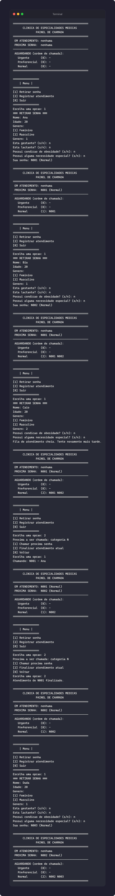

#### 13. Encerramento do programa
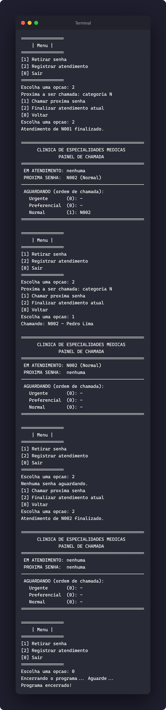

<a id="pt-limitacoes"></a>

## 🚧 12. Limitações

- Os dados ficam **apenas na memória**: ao encerrar o programa, as senhas e as filas são perdidas.
- A capacidade é de 50 pacientes **aguardando simultaneamente** por categoria.
- O programa não usa acentos nas mensagens, para evitar problemas de codificação em terminais diferentes.

---

<a id="en"></a>

# 🇺🇸 English

Final exam project for the **Algorithms and Computational Thinking** course — **Topic 2**: a queue ticket management system for a medical specialties clinic.

| | |
|---|---|
| 👤 **Author** | Piêtro Bitencourt Nunes |
| 📚 **Course** | Algorithms and Computational Thinking |
| 👩‍🏫 **Professor** | Karla Sartin |
| 🏫 **Institution** | UDF |
| 💻 **Language** | C (C99 or later) |

## 📑 Table of contents

1. [Goal](#en-goal)
2. [Features](#en-features)
3. [Operating rules](#en-rules)
4. [Project structure](#en-structure)
5. [Data structures](#en-data)
6. [Implemented functions](#en-functions)
7. [Assignment requirements](#en-requirements)
8. [How to build and run](#en-run)
9. [Usage examples](#en-examples)
10. [Design decisions](#en-decisions)
11. [Tests and evidence](#en-evidence)
12. [Limitations](#en-limitations)

<a id="en-goal"></a>

## 🎯 1. Goal

Build, in C, a command-line system that manages the **queue tickets** of a medical specialties clinic. The system registers the patient, classifies the ticket into one of three categories (Urgent, Priority or Regular), organizes the waiting queue according to priority, and lets the operator call and finish each appointment, always showing a panel with the current status.

> ⚠️ **Note:** age-based urgency classification does not replace clinical evaluation. It is exclusively a programming rule defined for this assignment.

<a id="en-features"></a>

## ✨ 2. Features

- **Patient registration**: name, age, gender and, for women, whether she is pregnant and whether she is breastfeeding; for everyone, whether they have obesity and whether they have any special need.
- **Automatic ticket classification**:

  | Category | Letter | Criterion |
  |---|---|---|
  | Urgent | `U` | age **over 80** |
  | Priority | `P` | pregnant, breastfeeding, obesity or special need |
  | Regular | `N` | all other cases |

- **Ticket generation** in the format `N001`, `P001`, `U001`, with **independent numbering per category** and no repeated numbers.
- **Interactive menu**:
  - `[1] Get a ticket`
  - `[2] Register an appointment` (call the next ticket and finish the current appointment)
  - `[0] Exit`
- **Call panel**, shown on every menu loop: ticket being served and its category, next ticket to be called, tickets waiting per category (in arrival order) and the number of waiting patients per category.
- **Multiple patients** can be registered in the same run.
- **Input validation** and handling of invalid operations.

<a id="en-rules"></a>

## 📏 3. Operating rules

1. **Urgent** tickets are called before **Priority** tickets, which are called before **Regular** ones.
2. **Within each category**, tickets are called in the order they were issued (FIFO).
3. A ticket that has already been served **never returns** to the queue.
4. A new patient can only be called when **no appointment is in progress**.
5. If the queue of a category is full, the ticket is **not issued** and that category's counter **does not advance** ("all or nothing"), so the numbering never has gaps.

<a id="en-structure"></a>

## 🗂️ 4. Project structure

```
clinica-senhas/
├── include/            Header files (.h)
├── src/                Source files (.c)
├── evidencias/         Test screenshots
├── output/             Generated executable (not versioned)
└── README.md
```

The file names inside `include/` and `src/` are listed in the [Portuguese section](#pt-estrutura).

| Module | Responsibility |
|---|---|
| `tipos.h` | Constants and data structures (`Paciente`, `Fila`, `Sistema`) |
| `entrada` | Reading and validating user input |
| `paciente` | Registration, classification and category name |
| `fila` | Circular queue and initial system state |
| `senha` | Ticket generation and ticket issuing (menu option 01) |
| `atendimento` | Checking, calling and finishing appointments (menu option 02) |
| `painel` | Menu and call panel |
| `main.c` | Only coordinates: initializes the system and loops the menu |

<a id="en-data"></a>

## 🧱 5. Data structures

- **`Paciente`** (`struct`): name, age, gender, pregnant, breastfeeding, obesity, special need, category, ticket number and code (e.g. `"P003"`).
- **`Fila`** (`struct`): a **circular queue** built on an array of `Paciente`, a `inicio` index and a `quantidade` counter.
- **`Sistema`** (`struct`): holds the three queues (`filaU`, `filaP`, `filaN`), the three issued-ticket counters, the patient being served and the `emAtendimento` flag. There are no global variables: the state is created in `main()` and passed to the functions by pointer.

### Circular queue

In a queue built on a plain array, the enqueue index only grows, so the queue would look "full" even when empty after many appointments. In the circular queue, the indexes **wrap around** the array using the `%` operator:

| Operation | How it works |
|---|---|
| Empty queue | `quantidade == 0` |
| Full queue | `quantidade == MAX_FILA` |
| Enqueue | writes to `itens[(inicio + quantidade) % MAX_FILA]` and does `quantidade++` |
| Dequeue | reads `itens[inicio]`, does `inicio = (inicio + 1) % MAX_FILA` and `quantidade--` |

So the capacity of **50 patients** (`MAX_FILA`) per category applies to patients **waiting at the same time**, not to the total of tickets issued in a day.

<a id="en-functions"></a>

## 🧩 6. Implemented functions

| File | Function | Description |
|---|---|---|
| `entrada.c` | `lerInteiro` | Reads an integer within a range; repeats until valid |
| `entrada.c` | `lerSimNao` | Reads a `y/n` style answer (`s`/`n`) and returns 1 or 0 |
| `entrada.c` | `lerTexto` | Reads a non-empty text and strips the newline |
| `paciente.c` | `cadastrarPaciente` | Asks the questions and returns the filled-in patient |
| `paciente.c` | `classificarPaciente` | Returns `U`, `P` or `N` according to the rules |
| `paciente.c` | `nomeCategoria` | Converts the category letter into text |
| `fila.c` | `inicializarSistema` | Zeroes the whole system (empty queues, counters at 0, nobody being served) |
| `fila.c` | `filaCheia` | Tells whether a queue is full |
| `fila.c` | `enfileirar` | Adds a patient to the end of the queue (returns 0 if full) |
| `fila.c` | `desenfileirar` | Removes the first patient (returns 0 if empty) |
| `fila.c` | `quantidadeNaFila` | Returns how many patients are waiting |
| `fila.c` | `obterFila` | Returns the address of the queue for a category |
| `senha.c` | `gerarSenha` | Increments the category counter and builds the ticket code (`%c%03d`) |
| `senha.c` | `retirarSenha` | Registers, classifies, checks queue space, generates the ticket and enqueues |
| `atendimento.c` | `consultarProxima` | Returns the category of the next ticket (U, then P, then N) without removing anyone |
| `atendimento.c` | `chamarProxima` | Removes the next patient from the queue and starts the appointment |
| `atendimento.c` | `finalizarAtendimento` | Finishes the current appointment |
| `atendimento.c` | `registrarAtendimento` | Option 02 submenu: call next, finish appointment or go back |
| `painel.c` | `exibirMenu` | Shows the main menu |
| `painel.c` | `exibirPainel` | Shows the call panel (read-only) |
| `painel.c` | `listarFila` *(internal)* | Lists the codes of a queue in arrival order |
| `painel.c` | `filaDaCategoria` *(internal)* | Returns the queue of a category as read-only |
| `main.c` | `main` | Initializes the system and loops the panel and menu until the user exits |

<a id="en-requirements"></a>

## ✅ 7. Assignment requirements

| Requirement | Where it is met |
|---|---|
| Working application in C | Whole project |
| Modular design with functions of specific responsibilities | Section 6 |
| `main()` does not hold all the logic | `main.c` only coordinates the calls |
| Decision structures | `if / else if` (classification, validation) and `switch` (menus, categories) |
| Repetition structures | `do...while` (menu and integer validation), `while` (yes/no and text input), `for` (queue listing) |
| Appropriate data types and storage structures | `struct`, arrays and circular queue |
| Interactive menu | `exibirMenu` and `registrarAtendimento` |
| Input validation and invalid operation handling | Section 9 |

<a id="en-run"></a>

## ▶️ 8. How to build and run

**Requirement:** `gcc` installed (on Windows, for example, MinGW-w64 or MSYS2).

> ⚠️ Run the commands **inside the `clinica-senhas` folder**, where `src/` and `include/` live. If your terminal is at the repository root, enter the folder first.

### Windows (PowerShell)

```powershell
cd clinica-senhas
New-Item -ItemType Directory -Force output
gcc -Wall -Wextra -Iinclude (Get-ChildItem src\*.c).FullName -o output\clinica_senhas
.\output\clinica_senhas
```

Or list the files explicitly:

```powershell
gcc -Wall -Wextra -Iinclude src\main.c src\entrada.c src\paciente.c src\fila.c src\senha.c src\atendimento.c src\painel.c -o output\clinica_senhas
```

### Linux / macOS

```bash
cd clinica-senhas
mkdir -p output
gcc -Wall -Wextra -Iinclude src/*.c -o output/clinica_senhas
./output/clinica_senhas
```

`-Iinclude` tells the compiler where the `.h` files are. The project builds with **no warnings** using `-Wall -Wextra`.

### In VS Code

1. Open the integrated terminal (`` Ctrl + ` ``).
2. Enter the project folder with `cd clinica-senhas`.
3. Run the build and run commands above.

<a id="en-examples"></a>

## 💡 9. Usage examples

### Getting a ticket

```
Escolha uma opcao: 1

=== RETIRAR SENHA ===
Nome: Maria Silva
Idade: 30
Genero:
[1] Feminino
[2] Masculino
Genero: 1
Esta gestante? (s/n): s
Esta lactante? (s/n): n
Possui condicao de obesidade? (s/n): n
Possui alguma necessidade especial? (s/n): n
Sua senha: P001 (Preferencial)
```

*(The program interface is in Portuguese.)*

### Panel with waiting patients

After issuing four tickets (one Priority, two Regular and one Urgent), the panel shows:

```
==============================================
      CLINICA DE ESPECIALIDADES MEDICAS
              PAINEL DE CHAMADA
==============================================
 EM ATENDIMENTO: nenhuma
 PROXIMA SENHA:  U001 (Urgente)
----------------------------------------------
 AGUARDANDO (ordem de chamada):
   Urgente       (1): U001
   Preferencial  (1): P001
   Normal        (2): N001 N002
==============================================
```

`U001` is called first even though it was issued after `P001` and `N001`, because the Urgent category takes precedence.

### Invalid operations handled

| Situation | System message |
|---|---|
| Calling with all queues empty | `Nenhum paciente aguardando.` |
| Calling while an appointment is in progress | `Finalize o atendimento atual antes de chamar o proximo.` |
| Finishing with no appointment in progress | `Nenhum atendimento em andamento.` |
| Category queue is full | `Fila de atendimento cheia. Tente novamente mais tarde.` |
| Invalid menu option, invalid age or non-numeric text | `Valor invalido. Digite um numero entre X e Y.` |
| Answer other than `s`/`n` | `Responda com s (sim) ou n (nao).` |
| Empty name | `O texto nao pode ser vazio.` |

<a id="en-decisions"></a>

## 🧠 10. Design decisions

- **Urgent age:** the rule is "over 80", so someone who is exactly 80 is **not** Urgent. A pregnant woman over 80 is Urgent, because the urgency check comes first.
- **Pregnancy and breastfeeding:** these questions are only asked when the informed gender is female. For other patients, the fields stay as "no".
- **Breastfeeding and obesity:** treated as Priority criteria, together with pregnancy and special needs.
- **"All or nothing" ticket issuing:** the system classifies the patient and checks for queue space **before** generating the number, so a refusal never consumes a ticket number.
- **Appointment submenu:** option 02 performs **one action at a time** (call or finish) and returns to the main menu, which shows the updated panel.
- **Read-only panel:** `exibirPainel` and `consultarProxima` receive the system as `const`, which guarantees they do not change any data.

<a id="en-evidence"></a>

## 🧪 11. Tests and evidence

### Classification

| Case | Expected result |
|---|---|
| Man, 81, no conditions | `U` |
| Man, 80, no conditions | `N` |
| Man, 80, special need | `P` |
| Woman, 85, pregnant | `U` |
| Woman, 30, pregnant | `P` |
| Woman, 30, breastfeeding | `P` |
| Man, 40, obesity | `P` |
| Woman, 25, no conditions | `N` |

### Priority and arrival order

Issuing `N001`, `N002`, `P001` and `U001` in this order, the calls happen in the order **U001, P001, N001, N002**.

### 📸 Screenshots

> Screenshots captured with the **TermSnap** VS Code extension and saved in [`evidencias/`](evidencias/). Descriptions are in the [Portuguese section](#pt-evidencias); the images are shared by both languages.

| # | Evidence |
|---|---|
| 1 | Build with no warnings |
| 2 | Initial menu and empty panel |
| 3 | Priority ticket (pregnant patient) |
| 4 | Urgent ticket (patient over 80) |
| 5 | Regular ticket |
| 6 | Panel with patients waiting in the three categories |
| 7 | Call respecting priority (Urgent first) |
| 8 | Arrival order within the same category |
| 9 | Finishing an appointment |
| 10 | Invalid operations handled |
| 11 | Input validation |
| 12 | Full queue without consuming a ticket number (`MAX_FILA` temporarily reduced) |
| 13 | Program exit |

<a id="en-limitations"></a>

## 🚧 12. Limitations

- Data lives **only in memory**: when the program exits, tickets and queues are lost.
- Capacity is 50 patients **waiting at the same time** per category.
- Messages have no accents, to avoid encoding issues in different terminals.

---

📄 Licença / License: [MIT](../LICENSE)